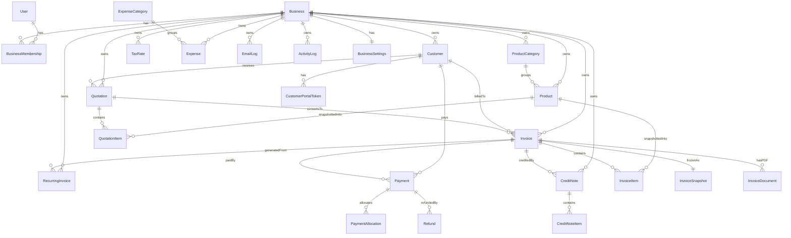

# Invoicing & Financial Management Platform — Architecture Proposal
**Date:** 2026-11-24 | **Status:** For approval — no code written yet
**Scope:** Greenfield. No existing invoicing project was found in `~/workspace/` or in memory — this is a new build, not a modification of PDFEDI / TwitterDown / ClearMark.

---

## 1. Technical Architecture

### 1.1 Principles
1. **Server is the source of truth.** Never trust frontend totals, tax, or balances. Every money figure is recalculated server-side from line items.
2. **Money is decimal, never float.** All money in Postgres `DECIMAL(19,4)`, Prisma `Decimal`, and `decimal.js` in TS. Display rounding only at render time.
3. **Issued documents are immutable.** An issued invoice / credit note is frozen as a snapshot + stored PDF. Corrections go through credit notes, never silent edits.
4. **Tenant isolation by construction.** Every business-owned row carries `businessId`. Every query is scoped by it. No endpoint ever accepts a `businessId` from the client without checking membership.
5. **Modular monolith first.** One Next.js app, cleanly layered, so it can be split later (PDF worker, email worker, scheduler) without a rewrite. No microservices on day one.
6. **Free / low-cost first.** No paid API is introduced without approval, matching your rule on other projects.

### 1.2 Stack — locked versions to use at scaffold time

| Layer | Choice | Why / note |
|---|---|---|
| Framework | Next.js 15 (App Router), React 19, TypeScript 5 strict | Server Components + Server Actions + Route Handlers in one deployable |
| UI | Tailwind CSS 4, shadcn/ui, Radix primitives, lucide-react | Accessible, themeable, light/dark via `next-themes` |
| Charts | Recharts | Dashboard only; no chart data is ever hardcoded |
| Forms / validation | React Hook Form + Zod (shared schemas in `lib/validation`) | Same Zod schema validates client + API + server |
| Auth | Auth.js (NextAuth v5) — email/password + OAuth optional | Credentials with `bcrypt` (cost 12), **JWT sessions** (Auth.js v5 forbids the Credentials provider with database sessions — see §5 note) |
| DB | PostgreSQL 16 + Prisma 6 | `Decimal`, transactions, migrations; see §2 |
| PDF | Playwright + Chromium, HTML/CSS templates | Server-side only. Runs in a separate worker process/container — **not** in Vercel serverless (Chromium is too large/slow there). **v1 reality: PDF generation runs in-process in the web process** (no queue/worker yet — see §5 note) |
| Email | Resend adapter + SMTP adapter behind one `EmailProvider` interface | `EMAIL_PROVIDER=resend|smtp|log` (log = dev, prints to console, sends nothing) |
| Storage | S3-compatible abstraction (`StorageProvider`) | Local disk in dev, Cloudflare R2 / S3 in prod. Same interface for logos, receipts, PDFs, signatures |
| i18n | `next-intl`, `en` + `ar`, RTL support | Arabic templates use Noto Naskh Arabic / Noto Sans Arabic embedded in PDF |
| Jobs / recurring | In-app scheduler + idempotency keys (see §1.5) | No separate queue on day one; BullMQ + Redis only if volume demands it |
| Testing | Vitest (unit) + Playwright (e2e) | Money maths, numbering, tenant isolation, PDF, and auth are tested first |
| Lint / format | ESLint, Prettier, `tsc --noEmit` in CI | CI fails on type error |

### 1.3 High-level diagram

```
Browser (Next.js UI, EN/AR, light/dark)
        │  HTTPS, Server Actions / REST /api/v1/*
        ▼
┌─────────────────────────────────────────────────────────┐
│ Next.js App (Vercel or Node container)                  │
│  • Auth.js sessions + RBAC middleware                   │
│  • API routes + Server Actions (Zod in, Decimal out)    │
│  • Money engine: lib/money (subtotal/discount/VAT/total)│
│  • Numbering service (advisory lock, never reuse)       │
│  • Portal: signed expiring tokens, public routes        │
├─────────────────────────────────────────────────────────┤
│ Workers (same repo, separate processes)                 │
│  • pdf-worker: Playwright → PDF → Storage               │
│  • mail-worker: queue → Resend/SMTP, retry, EmailLog    │
│  • scheduler: recurring invoices, overdue sweep, expiry │
└─────────────────────────────────────────────────────────┘
        │ Prisma
        ▼
PostgreSQL (Neon / Supabase / self-hosted)
  + S3-compatible storage (R2) for files/PDFs
  + Optional Redis only if BullMQ is adopted later
```

**Why the PDF worker is separate:** Playwright needs ~300–500 MB Chromium + fonts. Putting it in the web process makes deploys slow and requests time out on long invoices. The web app enqueues a `PDFJob`; the worker renders, stores the PDF, and writes `InvoiceDocument`. The UI polls / shows "Generating…" — it never blocks on Chromium.

### 1.4 Request flow — create / issue an invoice
1. UI posts draft (Zod-validated). Server recalculates all totals from items, ignores client totals.
2. Draft is editable. On **Issue**: one DB transaction — (a) lock the business's numbering sequence (`SELECT … FOR UPDATE` / advisory lock), (b) assign next number, (c) freeze `InvoiceSnapshot` (JSON of business + customer + items + totals + template + locale), (d) set status `ISSUED`, (e) write `ActivityLog`. No number is ever reused, even on concurrent requests.
3. PDF is generated from the **snapshot**, not from live customer/product rows. Later edits to a customer or price cannot change a historical PDF.
4. Payment: transaction inserts `Payment` + `PaymentAllocation`, recomputes `amountPaid / balance`, moves status `ISSUED → PARTIALLY_PAID → PAID`. Overdue is derived, not stored: `status IN (ISSUED,SENT,PARTIALLY_PAID) AND dueDate < today`.
5. Correction: create `CreditNote` referencing the invoice. Never `UPDATE` an issued invoice's money fields.

### 1.5 Recurring invoices & email — idempotency
- `RecurringInvoice` has `nextRunAt` + `lastRunAt`. Scheduler claims a run with `UPDATE … WHERE nextRunAt <= now AND status='ACTIVE' AND lastRunId IS NULL` (or a unique `runKey = recurringId + scheduledDate`), then generates exactly one invoice. A crash mid-run cannot duplicate it; a retry reuses the same `runKey`.
- Email is queued (`EmailLog` status `QUEUED → SENT/FAILED`), retried with backoff (3 attempts), never sent synchronously inside the invoice-issue request.

### 1.6 Tax layer — configurable, not hardcoded
- `TaxRate` table: `code` (`STD_5`, `ZERO`, `EXEMPT`, `OUT_OF_SCOPE`), `rate` (Decimal), `country`, `validFrom/validTo`, `isDefault`.
- `lib/tax` resolves the rate by code + date. Invoice items store `taxRateId + rateSnapshot + taxCategory` at issue time. Changing a rate never rewrites history.
- Default seed: UAE `STD 5%`, `ZERO 0%`, `EXEMPT 0%`. Currency default `AED`, but per-business and per-invoice currency is supported. **No claim of FTA compliance is made in-app** — the UI says "Tax Invoice" per template, and a settings note points the user to verify current FTA requirements.

### 1.7 Templates & preview
- Three templates: **Classic** (clean table, UAE Tax Invoice), **Modern** (accent colour, large totals), **Minimal** (compact, low-ink). All three share one data model (`InvoiceSnapshot`) and one CSS base, so **preview = PDF** — the live preview renders the same HTML the worker feeds to Playwright.
- Customisation is limited to: logo, primary colour, accent colour, footer, terms, signature image. No per-invoice free-form HTML (XSS / layout breakage risk).

---

## 2. Database — ER Diagram

### 2.1 Core rules
- Money: `DECIMAL(19,4)` everywhere. Quantities: `DECIMAL(12,3)`.
- Every business-owned table has `businessId` + index on `(businessId, createdAt)`; most also have a composite unique where it matters.
- Soft-delete is **not** used for financial documents. Drafts can be deleted; issued invoices, payments, and credit notes can only be cancelled/credited, never deleted.
- `updatedAt` on all tables; `ActivityLog` is append-only.

### 2.2 ER diagram (Mermaid)



### 2.3 Tables (key fields only — full Prisma schema in Phase 1)

| Table | Key fields |
|---|---|
| `User` | id, name, email (unique), passwordHash, emailVerifiedAt, createdAt |
| `Business` | id, name, slug, country, currency, defaultVatRateId, logoUrl, address, phone, email, website, trn, bankName, accountName, iban, swift, paymentInstructions, invoicePrefix, nextInvoiceNumber, terms, footer, signatureUrl |
| `BusinessMembership` | userId, businessId, role (`OWNER`/`ADMIN`/`MEMBER`/`VIEWER`), **unique(userId, businessId)** |
| `BusinessSettings` | businessId (unique), locale, timezone, dateFormat, pdfTemplate, primaryColor, emailFromName, smtp/resend config refs (secrets in env, never in DB plaintext) |
| `Customer` | businessId, type (`INDIVIDUAL`/`COMPANY`), name, companyName, email, phone, billingAddress, shippingAddress, country, trn, notes, status (`ACTIVE`/`INACTIVE`) |
| `ProductCategory` | businessId, name, **unique(businessId, name)** |
| `Product` | businessId, categoryId?, sku, name, description, unit, price (Decimal), taxRateId, taxCategory, isActive |
| `TaxRate` | businessId, code, name, rate, country, validFrom, validTo, isDefault |
| `Invoice` | businessId, customerId, number (**unique(businessId, number)**), status (`DRAFT/ISSUED/SENT/PARTIALLY_PAID/PAID/OVERDUE*/CANCELLED`), currency, issueDate, dueDate, supplyDate, subtotal, discountTotal, taxableAmount, vatAmount, grandTotal, amountPaid, balance, notes, terms, template, locale |
| `InvoiceItem` | invoiceId, productId?, description (snapshot), sku, quantity, unit, unitPrice, discountType, discountValue, taxRateId, taxRate (snapshot), lineTotal, sortOrder |
| `InvoiceSnapshot` | invoiceId (unique), payload (JSONB — full frozen invoice), templateVersion, createdAt |
| `InvoiceDocument` | invoiceId, type (`PDF`), storageKey, fileSize, checksum, createdAt |
| `Payment` | businessId, invoiceId, date, amount, currency, method (`CASH/BANK_TRANSFER/CARD/OTHER`), reference, notes, attachmentUrl, createdBy |
| `PaymentAllocation` | paymentId, invoiceId, amount — allows one payment to split across invoices later |
| `Refund` | paymentId, amount, reason, date |
| `Quotation` | businessId, customerId, number (**unique(businessId, number)**), status (`DRAFT/SENT/ACCEPTED/REJECTED/EXPIRED`), expiryDate, totals (same money fields as Invoice), convertedInvoiceId? |
| `QuotationItem` | quotationId, same shape as InvoiceItem |
| `Expense` | businessId, categoryId, vendor, title, date, amount, vatAmount, method, description, receiptUrl |
| `ExpenseCategory` | businessId, name, **unique(businessId, name)** |
| `RecurringInvoice` | businessId, customerId, frequency (`WEEKLY/MONTHLY/QUARTERLY/YEARLY/CUSTOM`), intervalDays?, startDate, endDate?, nextRunAt, lastRunAt, status (`ACTIVE/PAUSED/CANCELLED`), autoSend, template payload (items JSON) |
| `CreditNote` | businessId, invoiceId, number (**unique(businessId, number)**), reason, totals, status (`ISSUED/CANCELLED`) |
| `CreditNoteItem` | creditNoteId, invoiceItemId?, description, quantity, unitPrice, taxRate, lineTotal |
| `EmailLog` | businessId, relatedType, relatedId, to, subject, provider, status (`QUEUED/SENT/FAILED`), attempts, error, sentAt |
| `ActivityLog` | businessId, userId?, action, entityType, entityId, metadata (JSONB), ipAddress?, createdAt — append-only |
| `CustomerPortalToken` | customerId, invoiceId?, quotationId?, tokenHash, expiresAt, revokedAt, scope |

*`OVERDUE` is derived at read time (see §1.4), not stored as a separate transition — the stored status stays `ISSUED/SENT/PARTIALLY_PAID` and the UI/report flags it overdue when `dueDate < today AND balance > 0`.

### 2.4 Indexes & constraints to enforce in Prisma
- `Invoice(businessId, number)` unique; `Quotation`, `CreditNote` same pattern.
- `Invoice(businessId, customerId, createdAt)`, `Payment(businessId, invoiceId, date)`, `Expense(businessId, date)`, `ActivityLog(businessId, createdAt)`.
- Foreign keys `ON DELETE RESTRICT` for anything referenced by an issued document; `CASCADE` only for draft-only children (e.g. deleting a draft deletes its items).

---

## 3. Project Folder Structure

```
invoicing-platform/
├── README.md  .env.example  Dockerfile  docker-compose.yml
├── package.json  tsconfig.json  tailwind.config.ts  next.config.ts
├── prisma/
│   ├── schema.prisma
│   ├── migrations/
│   └── seed.ts                 # UAE tax rates, demo categories (seed only, never in prod dashboard)
├── public/
│   ├── fonts/                  # Noto Sans Arabic + Inter (subset, self-hosted)
│   └── locales/  (or src/messages/)
├── src/
│   ├── app/
│   │   ├── (auth)/login/  (auth)/register/  (auth)/forgot-password/
│   │   ├── (app)/                     # authenticated shell: sidebar + header
│   │   │   ├── dashboard/page.tsx
│   │   │   ├── invoices/  invoices/new/  invoices/[id]/  invoices/[id]/edit/
│   │   │   ├── customers/  products/  quotations/  payments/
│   │   │   ├── expenses/  recurring/  credit-notes/
│   │   │   ├── reports/  settings/  activity/
│   │   │   └── layout.tsx
│   │   ├── (portal)/portal/[token]/  # public, token-gated, no app shell
│   │   ├── api/
│   │   │   ├── v1/  # customers, products, invoices, invoices/[id]/pdf,
│   │   │   │        # payments, quotations, expenses, credit-notes, reports, settings
│   │   │   ├── auth/[...nextauth]/  health/  webhooks/
│   │   │   └── internal/pdf/  internal/mail/   # worker-only, secret-gated
│   │   ├── globals.css  layout.tsx
│   ├── components/
│   │   ├── ui/            # shadcn/ui primitives (button, dialog, table, toast…)
│   │   ├── layout/        # Sidebar, Header, ThemeToggle, Breadcrumbs
│   │   ├── dashboard/     # StatCard, RevenueChart, RecentLists
│   │   ├── invoices/      # InvoiceBuilder, LineItemsEditor, InvoicePreview, StatusBadge
│   │   ├── customers/ products/ payments/ expenses/ reports/ shared/
│   ├── lib/
│   │   ├── auth.ts  prisma.ts  env.ts  errors.ts  pagination.ts
│   │   ├── money.ts        # Decimal maths: lineTotal, discount, VAT, rounding
│   │   ├── tax.ts          # TaxRate resolution by code + date
│   │   ├── numbering.ts    # advisory-lock sequence, INV-2026-0001
│   │   ├── tenant.ts       # requireBusiness(), scopeWhere(), RBAC checks
│   │   ├── pdf/            # templates/classic|modern|minimal, renderHtml(), renderPdf()
│   │   ├── email/          # provider interface, resend.ts, smtp.ts, templates/
│   │   ├── storage/        # provider interface, local.ts, s3.ts
│   │   ├── validation/     # Zod schemas (shared client + server)
│   │   └── i18n/           # next-intl config, en.json, ar.json
│   ├── server/
│   │   ├── services/       # invoice.service, payment.service, quote.service,
│   │   │                   #   credit-note.service, report.service, recurring.service
│   │   └── jobs/           # pdf-worker.ts, mail-worker.ts, scheduler.ts
│   ├── hooks/  store/ (only if needed — prefer Server Components + URL state)
├── tests/
│   ├── unit/  money.test.ts  tax.test.ts  numbering.test.ts
│   ├── integration/  invoices.test.ts  payments.test.ts  tenant-isolation.test.ts
│   └── e2e/  auth.spec.ts  invoice-flow.spec.ts  pdf.spec.ts  arabic.spec.ts
└── docs/
    ├── ARCHITECTURE.md  (this file)  API.md  DEPLOYMENT.md  TROUBLESHOOTING.md
```

**Rules:** no giant components — `InvoiceBuilder` is split into `InvoiceForm / LineItemsEditor / InvoicePreview / TotalsPanel`. No page fetches data without `tenant.ts` scoping. No `any` in money code.

---

## 4. Development Roadmap (Phases 1–8)

Each phase ends with: tests run + UI verified + DB verified + a short report + **your approval before the next phase**. Nothing is called "done" while it is a placeholder.

| Phase | Scope | Exit criteria | Rough effort* |
|---|---|---|---|
| **1 — Foundation** | Repo scaffold, Prisma schema + migrations, Auth.js, RBAC + tenant middleware, settings shell, health endpoint, CI | Register/login/logout work; a user cannot see another business's rows (test proves it); `pnpm build` green | 1 week |
| **2 — Business, Customers, Products** | Business profile (incl. TRN, bank, numbering), customer CRUD + profile stats, product catalog + categories + CSV import/export | CRUD + search/filter/pagination + export all work on real DB data | 1–1.5 weeks |
| **3 — Invoice Builder** | Builder UI, money engine, live preview (same HTML as PDF), draft/issue flow, numbering lock | Totals verified against hand-calculated cases incl. mixed tax rates, % + fixed discounts, tax-inclusive/exclusive; preview matches PDF pixel-for-pixel on structure | 2 weeks |
| **4 — PDF Engine** | Playwright worker, 3 templates, EN/AR + RTL, multi-page, snapshots, download/print, stored PDFs | A4, repeating headers, no clipping/overlap on 1-page and 5-page invoices; Arabic PDF extracts real Arabic text | 1.5 weeks |
| **5 — Payments, Quotes, Credit Notes** | Multi/partial payments + receipts, quote → invoice conversion, credit notes + refunds | Partial + full payments move status correctly; quote conversion preserves link; credit note reduces balance, never deletes invoice | 1.5 weeks |
| **6 — Email, Expenses, Recurring** | Email queue + history + retry, expenses + categories + reports, recurring scheduler (idempotent) | Failed email retries and is logged; recurring run twice creates one invoice | 1.5 weeks |
| **7 — Portal, Reports, Analytics** | Token portal (view/download/accept-reject), reports (revenue, VAT, overdue, customer balances, product revenue) + PDF/CSV/Excel export | Portal token expiry/revoke works; report totals tie exactly to invoice + payment tables | 1.5 weeks |
| **8 — Hardening & Launch** | Security audit, full test suite, perf (indexes, pagination, caching), docs, staging deploy, backup/restore drill | All §23 tests pass; prod build + staging smoke test green; docs complete | 1 week |

**Phase status (2026-11-24): Phases 1–8 are DONE locally (commits through
Phase 8), none pushed, no repo, NOT deployed.** Phase 8 delivered:
security headers (nonce CSP, HSTS in prod), rate limits on auth + API +
portal, a validation audit (expense date filters, open-redirect guard),
audit-log completion (expense/category/email-retry/registration gaps
closed), tenant-isolation + MEMBER RBAC tests, Dockerfile + CI
verification, and full docs (`docs/`). Two exit-criteria items are
still open because they need a deployed environment, not more code:
**staging deploy + smoke test** and the **backup/restore drill**
(see `docs/RUNBOOK.md`). CI has never run (no repo/remote yet) and the
Docker image has never been built (no Docker daemon in the dev VM) —
the `docker` CI job is where the image build is proven.

**Total: ~10–12 weeks for one builder working in phases.** *Estimates, not commitments — re-estimated at each phase gate after you approve the previous phase.

**What is deliberately NOT in v1:** online card payments (no gateway until you choose one), UAE e-invoicing / Peppol integration (integration layer only — a `TaxIntegration` stub in `lib/`), multi-currency bank reconciliation, payroll, inventory stock levels.

---

## 5. Security Plan

| Area | Control |
|---|---|
| **Auth** | Auth.js, `bcrypt` 12, **JWT sessions (not DB sessions)**, secure + httpOnly cookies, `SameSite=Lax`, password min 10 chars, rate-limit login (5/min/IP **and** 5/min per email), no 2FA in v1 |
| **Tenant isolation** | `businessId` on every row; `requireBusiness()` in every Server Action / API route; **integration test** creates two businesses and proves cross-read returns 404, not data |
| **RBAC** | Roles: OWNER (all), ADMIN (all except delete business / manage owners), MEMBER (create/edit own-area), VIEWER (read-only). Checked server-side on every mutation, not just by hiding buttons |
| **Validation** | Zod on every input (API + actions); Prisma parameterised queries only (no raw SQL with interpolation); file uploads: allowlist (png/jpg/webp/pdf), 5 MB max, type-checked, stored outside web root, served via authenticated route (never executed) |
| **XSS / CSRF** | React escaping by default; no `dangerouslySetInnerHTML` for user content (invoice HTML is server-rendered from validated data); SameSite cookies + origin check on mutations; nonce CSP in `src/middleware.ts` |
| **Secrets** | `.env` only, never committed; Resend/SMTP/S3 keys in env or secret manager; no secret in `BusinessSettings` DB row, only a provider name + masked hint |
| **Rate limiting** | In-memory limiter (`src/lib/rate-limit.ts`), Redis in prod with >1 instance: auth 5/min/IP (+ 5/min/email), portal token verify 10/min/IP, API 60/min/IP per route group |
| **Audit** | `ActivityLog` append-only: registration, invoice issue/send/pay/cancel, credit note, settings change, portal access/decisions, expense + category changes, email queue/send/retry. No delete endpoint for logs. Login attempts are **not** stored (known gap, see note) |
| **PDF / portal** | PDFs served only via authorised download endpoint (checks membership or valid portal token); portal tokens are `sha256(token)` stored, 30-day default expiry (1–365), revocable, single-scope (one invoice/quote/customer) |
| **Backups** | Daily Postgres PITR / snapshot (provider-managed), restore drill before launch then quarterly; file storage versioned; `pg_dump` runbook in `docs/RUNBOOK.md` |
| **Headers / transport** | HTTPS only (HSTS in production), `X-Content-Type-Options`, `Referrer-Policy`, CSP `frame-ancestors 'none'` (no separate X-Frame-Options — one mechanism), `Permissions-Policy` minimal |
| **Dependencies** | `npm audit --audit-level=high` in CI (cannot run in the dev VM — the egress proxy blocks the registry audit endpoint); Playwright Chromium pinned, not `latest` |

**Known limits recorded in Phase 8 (do not promise otherwise):**

- **JWT sessions, no server-side revocation.** Auth.js v5 forbids the
  Credentials provider with database sessions, so sessions are JWTs
  signed with `NEXTAUTH_SECRET` (30-day expiry). There is no "log out
  everywhere"; rotating `NEXTAUTH_SECRET` invalidates all sessions at
  once (see `docs/RUNBOOK.md`).
- **PDF generation is in-process.** The architecture called for a
  separate PDF worker; v1 renders PDFs in the web process (no
  queue/worker). A burst of large PDFs can slow the web process. The
  Dockerfile installs Chromium in the runner image for this.
- **No cron daemon.** Recurring schedules and the email queue run from
  manual buttons; unattended operation needs a secured cron trigger
  (see `docs/RUNBOOK.md`).
- **Login attempts are not audit-logged.** Registration is
  (`user.registered`); individual login successes/failures are not
  stored in `ActivityLog`.

**Pre-push rule (your standing rule):** secret scan before every GitHub push, same as PDFEDI/TwitterDown — no tokens, keys, or `.env` values in any file.

---

## 6. Estimated Infrastructure Requirements

### 6.1 Environments
- **Local dev:** Node 20+, Postgres 16 (Docker), Chromium (Playwright), local storage. Cost **$0**.
- **Staging:** same as prod, smaller tier, seeded with fake data only. Cost **~$5–15/mo**.
- **Production (recommended v1):**

| Component | Recommended v1 | Why | Est. cost/mo |
|---|---|---|---|
| Web app | Render Web Service (Node, 512 MB–1 GB) **or** Vercel Pro if PDF worker is separate | Render keeps web + workers in one place; Vercel is fine for the web tier only | $7–25 |
| PDF worker | Same Render service as a background worker, or a second 512 MB service | Chromium needs RAM; do not run it serverless | $7 (shared) – $15 |
| Database | Neon free tier (3 GB) → Scale when >3 GB, **or** Supabase free tier | Managed Postgres, PITR, branching for staging | $0–25 |
| Storage | Cloudflare R2 (10 GB free, no egress fees) | Logos, receipts, PDFs | $0–5 |
| Email | Resend free (100/day, 3,000/mo) → $20 tier when volume grows | Transactional email; SMTP fallback is $0 if you already have a mailbox | $0–20 |
| Domain + DNS | Cloudflare Registrar | You already use Cloudflare for twitterdown.app | ~$10/yr |
| Monitoring | Sentry free tier + provider logs + `/api/health` | Error tracking from day one | $0 |

**Production total, v1: ~$15–40/mo** (mostly Render + DB when you outgrow free tiers). **$0/mo is possible** for a personal / single-business pilot on free tiers (Vercel Hobby + Neon free + R2 free + Resend free) with the PDF worker on Render free — but free Render sleeps, so PDF generation would be slow on first use. I recommend the ~$15/mo Render starter for anything real.

### 6.2 What it needs to run
- Node 20 LTS, Postgres 16, 1 GB RAM minimum for the worker host (Chromium), 512 MB for web.
- Env vars (see `.env.example` in Phase 1): `DATABASE_URL`, `NEXTAUTH_SECRET`, `NEXTAUTH_URL`, `EMAIL_PROVIDER`, `RESEND_API_KEY` *or* `SMTP_*`, `STORAGE_PROVIDER`, `R2_*` / `S3_*`, `PDF_WORKER_SECRET`.
- No paid API is required to launch v1.

### 6.3 Scaling notes
- The design scales by adding worker replicas and read replicas later; no re-architecture needed until ~10k invoices/mo, at which point: BullMQ + Redis for jobs, Postgres read replica for reports, CDN for public assets.

---

## 7. Decisions needed from you (before Phase 1)

1. **Approve this architecture as-is, or with changes?** (stack, PDF worker split, Decimal approach)
2. **Project name + repo name?** (e.g. `invoicing-platform` — creates `github.com/Ch-israr/<repo>`)
3. **Hosting preference?** Render (web + worker together, my recommendation) vs Vercel web + Render worker.
4. **Auth:** email/password only to start, or also Google login?
5. **Single-business first, or multi-business from day one?** Architecture supports multi-business; Phase 1 can ship single-business UI to move faster.
6. **Do you want a demo/seed business in staging, or completely empty production?** (Dashboard must never show hardcoded numbers — seed data is staging-only.)

**I will not write code, create the repo, or deploy anything until you approve.**
